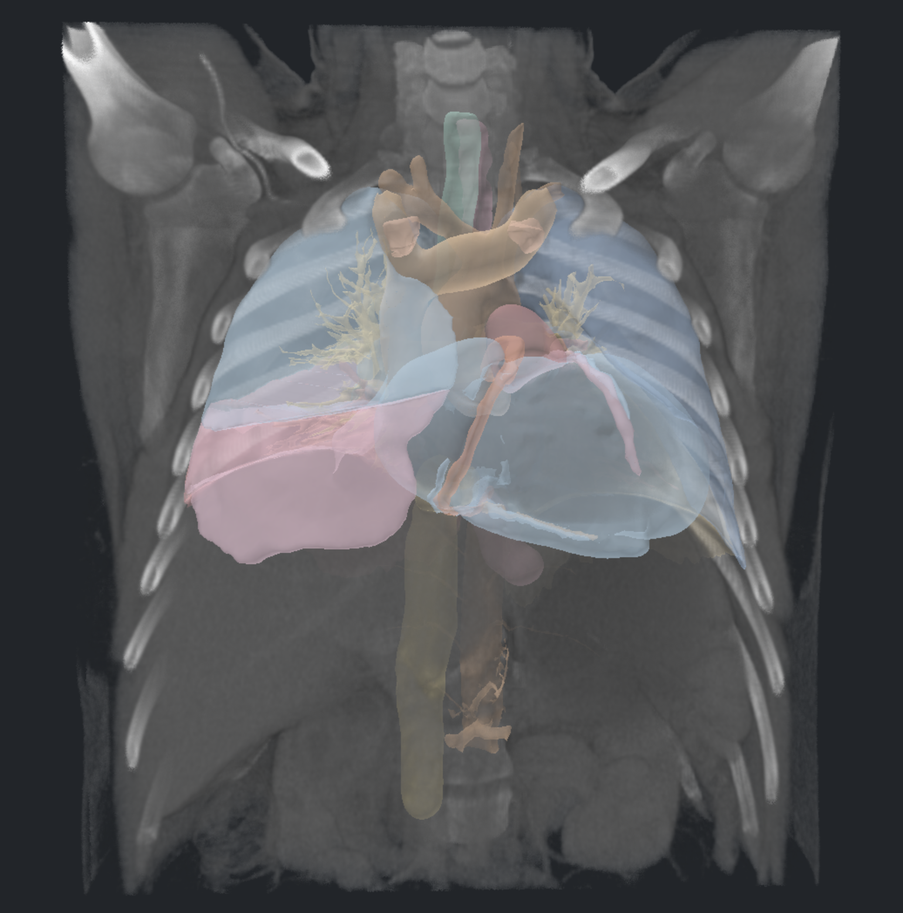

   

[Live version](https://vangelov.github.io/volumesh/)

## Volumesh

A medical visualization renderer combining direct volume rendering with depth-peeled order-independent transparency (OIT) for spatially registered 3D anatomical meshes.

### Features

- Direct volume rendering of medical imaging data
- Order-independent transparency for overlapping 3D meshes using depth peeling
- Spatially registered rendering of anatomical meshes within volumetric scans
- Controls for adjusting rendering parameters
- Multiple anatomical atlases

### Data Sources & Attribution

Medical imaging and anatomical mesh data are sourced from the [Open Anatomy Project](https://www.openanatomy.org).
The viewer includes links to the original atlas pages, where additional information about the datasets and their contributors can be found.

## Scripts

In the project directory, you can run:

#### `npm run dev`

Runs the app in the development mode.\
Open [http://127.0.0.1:5173/](http://127.0.0.1:5173/) to view it in the browser.

#### `npm run build`

Builds the app for production in the `dist` folder.

### DICOM folder import

Use **Import DICOM Folder** to select a local folder (including subfolders).
Each CT/MR Series Instance UID becomes a separate volume in the new anatomy;
use **Volume → Variant** to switch series. Imports stay in memory for this session.
RTSTRUCT files in the folder are converted into named, colored 3D meshes and
added to the anatomy's mesh controls. They are matched to their referenced CT/MR
series by image and Frame of Reference UIDs. With structures present, volumes
from a different frame are excluded; different frames require a registration
transform and cannot be aligned by an LPS-to-RAS conversion alone.

The importer supports classic single-frame monochrome 8/16-bit images with
uncompressed little/big-endian or JPEG Lossless (.57/.70) transfer syntaxes.
Enhanced/multiframe, other compression formats, single-slice images, and
inconsistent or irregular stacks produce an error. Temporal/echo stacks sharing
a series UID and repeated spatial positions must be separated before import.

Slices are sorted by Image Position Patient projected onto the orientation normal.
Pixel Spacing and the full slice displacement (including affine gantry tilt) define
the voxel axes in patient LPS millimeters. These convert to RAS and normalize
against the combined volume bounds, including when RTSTRUCT meshes exist.
Contours already use patient coordinates: meshes receive the same LPS-to-RAS
conversion and display normalization, without fitting the volume to the meshes. CT/MR from different
frames of reference are not registered automatically. Rescaled pixel intensities
are normalized per volume to the renderer's existing 8-bit representation.

Use **RTSTRUCT Reconstruction → Method** before import or change it afterward
to compare meshes without reloading the volume. The camera, volume settings,
selected structure, mesh colors and visibility are preserved during comparison.

- **Smoothed surface nets (default)**: an interpolated binary-mask surface with
  10 paired Taubin smoothing iterations, constrained to original surface cells
  to limit shape changes. Tiny components are preserved without smoothing.
- **Surface nets**: the same interpolated surface without relaxation.
- **Voxel boundaries (original)**: exposed voxel faces, useful as a baseline.

Browser reconstruction runs in a worker. All methods share the same contour
rasterization, patient coordinates, caps, XOR holes and volume normalization.
The source contour resolution still limits detail: smoothing changes the surface
approximation and does not recover missing anatomical detail. Missing contour
slices remain empty; this does not interpolate across gaps. Contours between image
planes are sampled to the nearest plane and reported in Info; open/point contours
are skipped and reported. Limits are 128 million voxels and two million vertices
per ROI. The smoother default is for visual comparison, not a guarantee of greater
anatomical accuracy.

The implementation combines dual surface nets, source-cell constraints and
paired Taubin smoothing. Background: [Gibson, Constrained Elastic
Surface Nets](https://merl.com/publications/docs/TR99-24.pdf) and
[Taubin, A Signal Processing Approach to Fair Surface Design](https://doi.org/10.1145/218380.218473).

The RTSTRUCT reader also recovers exports that store the scalar coordinate count
in Number of Contour Points. It accepts this only when the complete numeric
field contains exactly that many values arranged in XYZ triplets, and reports
the corrected counts in Info. Other coordinate-count mismatches remain errors.
